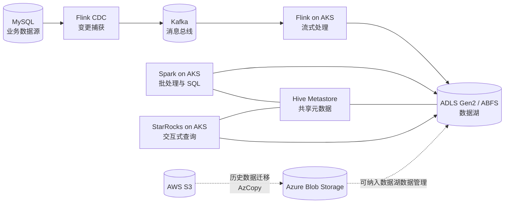

# 基于 AKS 与 Azure Data Lake Storage 的大数据平台方案

## 1. 方案概述

本方案以 Azure Kubernetes Service（AKS）为统一运行底座，以 Azure Data Lake Storage Gen2（ADLS Gen2，以下称 ABFS）作为共享数据湖存储，组合 Flink、Spark、Hive Metastore 和 StarRocks，提供从数据接入、实时处理、数据湖存储、元数据管理到交互式查询的端到端能力。

平台面向需要同时处理实时与离线数据，并希望在云上统一管理计算资源和数据的团队。Flink 负责持续数据处理，Spark 负责批处理和 SQL 计算，Hive Metastore 提供共享的表元数据，StarRocks 通过 Hive External Catalog 查询湖上数据。历史数据还可通过 AzCopy 从 AWS S3 迁移至 Azure Blob Storage。

## 2. 建设目标

- **统一数据存储**：将数据和计算解耦，数据以文件形式落在 ABFS，供不同计算引擎访问。
- **兼顾实时与离线**：通过 Flink 处理持续流入的数据，通过 Spark 承担批处理、SQL 作业及相关服务。
- **共享元数据**：使用 Hive Metastore 管理 Hive 表和 Warehouse 元数据，支持 Spark 与 StarRocks 等组件协同访问。
- **弹性运行**：基于 AKS 和 Kubernetes Operator 管理计算作业，按作业或组件配置副本、资源和调度位置。
- **支持湖上查询**：以 StarRocks 作为面向交互式分析的查询引擎，在不要求 StarRocks 本地保存业务数据的模式下读取外部数据。
- **支持云间数据迁移**：提供 S3 到 Azure Blob Storage 的递归复制路径，便于历史数据搬迁。

## 3. 总体架构

### 主要数据链路

1. **实时采集**：Flink CDC 连接 MySQL，捕获指定数据库表的变更，并将不同源表路由到相应 Kafka Topic。当前示例使用 Debezium JSON 格式。
2. **流式落湖**：Flink 流任务消费 Kafka 数据，执行持续处理，并将结果写入 ABFS。任务通过 Kubernetes Operator 部署和管理。
3. **离线计算**：Spark 客户端或 Spark Thrift Server 承载批处理和 SQL 访问；作业在 AKS 上运行，数据、事件日志和相关目录配置到 ABFS。
4. **元数据管理**：Hive Metastore 保存表结构和数据位置等元信息，Warehouse 目录配置在 ABFS；元数据库可连接外部 MySQL，也可按 Helm Chart 支持的方式启用内置数据库。
5. **交互式查询**：StarRocks 通过 Hive External Catalog 连接 Hive Metastore，并从 ABFS 读取外部表数据。配置为 FE 与 CN 的计算型部署，不依赖 BE 保存湖上业务数据。
6. **历史数据迁移**：使用 AzCopy 将 AWS S3 对象递归复制到 Azure Blob Storage；完成后可按数据目录和元数据管理要求纳入湖上数据体系。

## 4. 组件职责与部署形态

| 组件 | 职责 | 本仓库体现的部署方式 |
|---|---|---|
| AKS | 承载平台服务、Operator 和弹性计算作业 | 通过节点选择器将不同组件调度到对应节点池或节点标签 |
| Flink Kubernetes Operator | 管理 Flink 集群与 FlinkDeployment 生命周期 | Helm 安装；配置并行度、协调周期和 Kubernetes 客户端 QPS 等参数 |
| Flink | 实时数据接入、流处理与湖上写入 | FlinkDeployment；启用 Kubernetes HA、Checkpoint、Savepoint 和 ABFS 状态目录 |
| Flink CDC | 捕获 MySQL 表变更并路由至 Kafka | 提供 MySQL 到 Kafka 的 pipeline 示例，按表配置 Topic |
| Kafka | 解耦数据采集端与下游流处理 | 作为 CDC 输出和 Flink 流任务输入；Kafka 集群由外部环境提供或另行部署 |
| Spark Operator | 管理 Spark on Kubernetes 作业 | Helm 安装；可启用 Webhook、批调度器和 UI Ingress |
| Spark | 批处理、SQL 作业及 Thrift Server 查询入口 | Helm Chart；配置动态资源分配、Executor 节点选择和 ABFS 访问 |
| Spark History Server | 展示 Spark 作业事件日志 | 事件日志和历史日志目录配置到 ABFS |
| Hive Metastore | 提供共享的 Hive 表元数据服务 | Helm 部署；支持配置外部元数据库、ABFS Warehouse 和 Workload Identity |
| StarRocks | 提供湖上交互式查询 | FE + CN；通过 Hive External Catalog 访问 Metastore 和 ABFS |
| AzCopy | 跨云搬迁对象数据 | 将 S3 指定路径递归复制到 Azure Blob Storage |

## 5. 数据与元数据组织

- **数据文件**：统一存放于 ABFS 容器下，按业务域、数据集和处理阶段规划目录。具体目录命名、分区字段和保留期限应由数据治理规范确定。
- **表元数据**：由 Hive Metastore 管理；Spark 与 StarRocks 应使用一致的 Metastore 地址和兼容的数据格式约定。
- **流任务状态**：Flink Checkpoint、Savepoint 和高可用数据目录配置在 ABFS 上，以支持任务恢复和升级。
- **Spark 作业记录**：Spark Event Log 和 History Server 日志目录配置在 ABFS，支持作业历史查看。
- **迁移数据**：S3 到 Blob 的复制目标需要与后续数据湖目录规范对齐；对象复制本身不会自动创建 Hive 表或完成元数据注册。

## 6. 高可用、弹性与资源管理

方案通过 Kubernetes 和各组件自身机制提升可用性与资源利用率：

- **Flink 高可用与恢复**：启用 Kubernetes HA，并将 Checkpoint、Savepoint 和 HA 数据目录放在 ABFS；任务使用 `last-state` 升级模式时，可基于已有状态恢复。
- **Flink 自适应扩缩**：配置作业自动扩缩相关指标窗口、目标利用率、稳定时间和扩缩容宽限期。实际效果仍取决于作业指标、最大并行度、集群资源和 AKS 节点容量。
- **Spark 动态资源分配**：Thrift Server 示例启用 Executor 动态分配并设定最小、最大 Executor 数量；Executor 和 Driver 可通过节点选择器进行隔离调度。
- **关键服务副本**：文档示例为 cert-manager、Spark History Server、Thrift Server 等配置了独立资源或调度参数；具体副本数及容错能力应结合服务等级目标评估。
- **存储冗余**：Hive Chart 支持为内置数据库 PVC 配置 Azure Disk `Premium_ZRS` StorageClass，但是否可用取决于区域和订阅支持情况。ABFS 本身的冗余策略需根据 Azure Storage 配置确认。

## 7. 安全与访问控制

平台涉及 AKS、Azure Storage、数据库、Kafka 和跨云数据源，建议按最小权限原则配置身份与凭据：

- **Azure 身份认证**：Hive 示例启用 Workload Identity；Flink 和 Spark 使用托管身份相关配置访问 ABFS。应为每个服务账号绑定独立身份，并仅授予所需容器或目录权限。
- **凭据管理**：数据库密码、存储账户密钥、AWS Access Key、Kafka 凭据等不得写入版本控制中的明文配置。建议使用 Azure Key Vault、Kubernetes Secret 或受控的密钥注入机制，并配置轮换流程。
- **网络边界**：生产环境应根据网络拓扑限制 Metastore、数据库、Kafka、Thrift Server 和管理端点的可达范围；对外服务优先采用私网入口及受控访问策略。
- **镜像供应链**：将运行镜像导入 Azure Container Registry（ACR），为生产环境固定版本，并通过受控的镜像扫描、发布和回滚流程管理。
- **访问审计**：对 Azure 身份授权、数据库访问、平台管理操作和数据访问建立审计及告警策略。

## 8. 部署实施建议

建议按依赖关系分阶段实施，先验证基础设施和身份权限，再部署计算与查询组件。

### 阶段一：基础环境准备

1. 准备 AKS、节点池、命名空间、网络和 Azure Storage。
2. 确认 ABFS 层级命名空间、容器、访问策略及 Workload Identity 或托管身份配置。
3. 准备 ACR、镜像拉取权限，以及外部 MySQL、Kafka 等依赖服务的网络连通性。
4. 为组件规划节点标签、CPU/内存配额、存储类别和内部/外部服务入口。

### 阶段二：元数据服务与 Operator

1. 部署 Hive Metastore 及其元数据库，验证服务端口和数据库 Schema 初始化。
2. 安装 Spark Operator、Flink Kubernetes Operator 及必要的证书管理组件。
3. 核对 Operator 监听的命名空间、RBAC 权限、Webhook 与 CRD 状态。

### 阶段三：计算和数据链路

1. 部署 Spark 服务及 History Server，验证 ABFS 访问、Metastore 连接和示例作业运行。
2. 部署 Flink 作业，先验证 Checkpoint 和状态目录，再验证 Kafka 消费与 ABFS 写入。
3. 部署或接入 Flink CDC Pipeline，检查 MySQL 权限、初始快照、增量变更及 Topic 路由。
4. 部署 StarRocks FE/CN，创建 Hive External Catalog，验证表发现和查询结果。

### 阶段四：迁移、验收与上线

1. 通过 AzCopy 执行小批量 S3 数据复制，核对对象数量、大小和抽样内容。
2. 按数据目录规范完成表注册或元数据创建。
3. 执行端到端数据校验、故障恢复演练、资源压力测试和权限检查。
4. 建立变更、发布、回滚、备份恢复和日常巡检流程后再扩大数据量或开放用户访问。

## 9. 验收建议

上线前至少验证以下内容：

- Flink CDC 能连接 MySQL，按预期捕获数据并路由到正确的 Kafka Topic。
- Flink 流任务能够消费数据、写入 ABFS，并在重启或升级后按预期恢复状态。
- Spark 作业可读写 ABFS、访问 Hive Metastore，History Server 能显示作业事件日志。
- Hive Metastore 可持久化元数据；服务重启后表定义和 Warehouse 路径仍可用。
- StarRocks 能发现 Hive Catalog 中的目标表并完成代表性查询。
- S3 到 Blob 的复制结果通过对象数量、大小及内容抽样核对；重复执行和失败重试策略符合迁移要求。
- 身份权限符合最小权限原则，凭据未进入 Git；资源配额、告警、日志和故障处置责任明确。

## 10. 当前材料范围与生产化补充项

仓库当前提供的是组件部署配置、Helm Chart、镜像构建相关文件及若干数据链路示例，适合作为平台落地的技术基础。它并未完整定义所有生产环境参数。上线前还需针对实际环境补充和验证：

- Kafka 集群部署或托管方案、Topic 分区与保留策略、认证和容灾配置。
- MySQL、外部元数据库的高可用、备份恢复、连接池和账号权限方案。
- ABFS 容器布局、数据格式、分区策略、生命周期管理、加密与灾备要求。
- Kubernetes 节点池容量、自动伸缩策略、网络策略、入口治理、配额和多租户隔离。
- 监控指标、集中日志、告警阈值、SLO、升级窗口和故障演练计划。
- CDC 初始化快照、重复事件处理、Schema 演进、数据质量校验与回补策略。
- StarRocks 查询并发、缓存策略、Catalog 行为和目标文件格式的兼容性测试。
- 组件版本兼容矩阵、镜像扫描、漏洞修复和定期升级机制。

因此，资源规模、可用性等级、恢复目标（RTO/RPO）和实际吞吐能力应通过目标区域、数据规模及压测结果确定，不应仅依据示例配置推断。

## 11. 仓库文档索引

- [Flink 部署与流任务配置](./flink/README.md)
- [Spark 部署配置](./spark/README.md)
- [Spark Operator 配置](./spark/spark-operator.md)
- [Hive Metastore 配置](./hive/README.md)
- [StarRocks 部署与 Hive Catalog 查询](./starrocks/README.md)
- [AWS S3 到 Azure Blob Storage 数据迁移](./blob/s3-to-blob.md)
